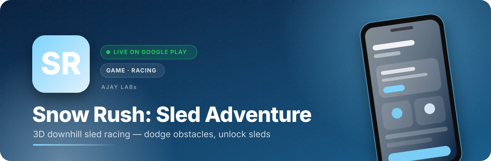

   

---

## ✨ Overview

Snow Rush is a casual 3D sled racing game. Race downhill through snowy mountain and forest tracks, dodge trees, rocks and barriers, and collect coins and gems to unlock new sleds. Tracks get faster and harder as you progress.

## 🚀 Features

<table>
<tr>
<td width="50%" valign="top"><h3>🛷 Downhill sled racing</h3>Fast, simple controls built for quick sessions</td>
<td width="50%" valign="top"><h3>🌲 Winter worlds</h3>Snowy mountain and forest tracks</td>
</tr>
<tr>
<td width="50%" valign="top"><h3>🪨 Obstacle courses</h3>Trees, rocks and barriers to dodge</td>
<td width="50%" valign="top"><h3>🌉 Varied terrain</h3>Turns, slopes, bridges, cabins and ramps</td>
</tr>
<tr>
<td width="50%" valign="top"><h3>🪙 Coins & gems</h3>Collect currency as you ride</td>
<td width="50%" valign="top"><h3>🔓 Unlockable sleds</h3>Spend coins and gems on new sleds</td>
</tr>
<tr>
<td width="50%" valign="top"><h3>📈 Rising difficulty</h3>Each level ramps up speed and challenge</td>
<td width="50%" valign="top"><h3>🎨 Colourful 3D graphics</h3>Stylised low-poly winter look</td>
</tr>
</table>

## 📱 Screenshots

  
  
  
   
  
  
  

## 🔒 About this repository

This is a **product showcase**. The source code, credentials and signing keys are private. Happy to walk through the architecture and code in an interview — reach out below.

---

  Designed & built by <a href="https://github.com/theajay17"><b>Ajay Kumar Saw</b></a> · Wushang Labs  
  
  
  

